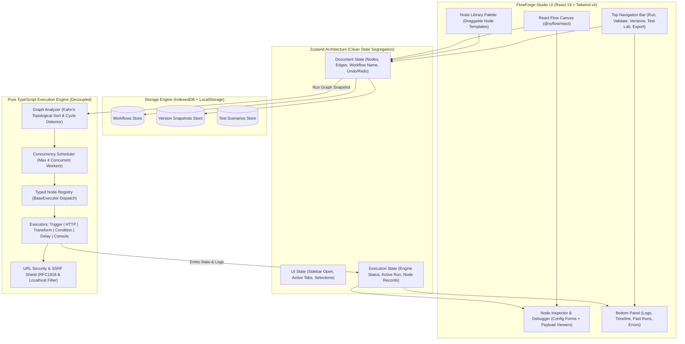

# FlowForge — Visual Workflow Programming Studio

[](https://www.typescriptlang.org/)
[](https://react.dev/)
[](https://vitejs.dev/)
[](https://tailwindcss.com/)
[](https://reactflow.dev/)
[](https://vitest.dev/)
[](https://playwright.dev/)
[](LICENSE)

FlowForge is a web-native **Visual Workflow Programming Studio**. It allows software engineers and technical teams to design, connect, configure, execute, debug, and test complex automation graphs through an interactive node-based interface.

Built from first principles with **React 19**, **strict TypeScript**, **@xyflow/react**, and a decoupled **Directed Acyclic Graph (DAG) Execution Engine**.

---

## 🌟 Key Features

### 1. Visual Canvas & Node System
- **6 Core Nodes**:
  - **Manual Trigger**: Workflow ignition point accepting custom JSON test payloads.
  - **HTTP Request**: Secure REST requester supporting `GET`, `POST`, `PUT`, `DELETE`, `PATCH`, custom headers, timeout management, and strict SSRF blocking.
  - **Transform Data**: Pure declarative JSON path extraction, field picking, key renaming, parsing, and serialization without unsafe `eval()` or `Function()`.
  - **Condition**: Logic branching (`==`, `!=`, `>`, `<`, `contains`, `is_empty`, `is_not_empty`) with distinct `true` and `false` output routing.
  - **Delay**: Configurable sleep timers with safe execution guards.
  - **Console Output**: Multi-level runtime inspector (`info`, `warn`, `error`, `success`, `log`) for downstream telemetry.
- **Connection Rules**: Strict port validation preventing self-connections, duplicate edges, loops, and invalid trigger inputs.
- **Gestures & Canvas Controls**: Drag-and-drop palette, multi-selection, smooth pan/zoom, interactive minimap, and snap-to-grid dots.

### 2. High-Performance DAG Execution Engine
- **Decoupled Architecture**: 100% pure TypeScript engine with zero coupling to React lifecycle or DOM components.
- **Topological Sorting**: Kahn's algorithm resolves deterministic execution ordering and immediately flags circular loops with cycle trace paths.
- **Dependency-Aware Concurrency**: Independent branches execute concurrently using bounded asynchronous concurrency pools (default 4 workers).
- **Branch-Aware Routing**: Condition nodes selectively propagate down active handles while gracefully flagging downstream unchosen branches as `skipped`.
- **SSRF & Network Security**: Blocks RFC 1918 private subnets, localhost loopbacks (`127.0.0.1`, `::1`), link-local metadata addresses (`169.254.169.254`), and automatically masks `Authorization`, `Cookie`, and `Api-Key` headers in logs.

### 3. Integrated Execution Debugger
- **Visual Status Badges**:
  - `Grey`: Pending / Ready
  - `Blue`: Running (active spinner with pulse animation)
  - `Green`: Successful completion
  - `Red`: Node execution error
  - `Yellow`: Skipped branch
- **Node Inspector**: Inspects captured input payload received from upstream, output payload emitted downstream, exact node execution duration in milliseconds, branch evaluation results, and error stack details.
- **Execution Timeline**: Chronological event waterfall charting workflow start, individual node latencies, and final graph resolution.
- **Interactive Log Panel**: Real-time log sink supporting level filters (`info`, `warn`, `error`, `success`), text search, clear logs, and clickable node links.
- **Past Run Selector**: Compare timeline and log traces across multiple workflow executions.

### 4. Persistence, Versioning & Testing Laboratory
- **IndexedDB Native Storage**: Local storage with fallback using dedicated object stores for workflows, version snapshots, and test suites.
- **JSON Import & Export**: Export workflows as formatted `.json`; validate imports using strict Zod schemas (`workflowImportSchema`) with graceful error recovery.
- **Version History & Rollbacks**: Create named snapshot tags (e.g. `v1.0`, `v1.1`), view change logs, and restore any previous version onto the canvas with a single click.
- **Workflow Testing Laboratory**: Define test scenarios with custom trigger payloads and multi-target assertion rules (`equals`, `contains`, `greater_than`, `less_than`, `exists`). Compares actual output against expected criteria and highlights pass/fail diffs.

---

## 🏛 Architecture Diagram



---

## 💻 Technology Stack

| Component | Technology | Version | Purpose |
| :--- | :--- | :--- | :--- |
| **Framework** | React | `19.3.1` | UI presentation layer |
| **Language** | TypeScript (Strict) | `~6.0.2` | Type-safety, zero `any` policy |
| **Bundler** | Vite | `8.3.8` | Lightning fast HMR & production builds |
| **Canvas** | @xyflow/react | `13.0.2` | Node-based graph editing canvas |
| **Styling** | Tailwind CSS | `4.3.5` | Modern CSS-first developer theme |
| **State** | Zustand | `5.1.0` | Segregated document, UI, and execution state |
| **Validation** | Zod | `4.6.7` | Node configurations & JSON import validation |
| **Storage** | IndexedDB | Native | Local browser persistence & version history |
| **Unit Testing** | Vitest | `5.1.1` | High-speed unit and performance tests |
| **E2E Testing** | Playwright | `1.65.1` | End-to-end browser user workflow testing |
| **Icons** | Lucide React | `1.76.0` | Developer tool iconography |

---

## 🚀 Getting Started

### Prerequisites
- Node.js `18.0.0` or higher
- npm `9.0.0` or higher

### Installation
1. Clone the repository:
   ```bash
   git clone https://github.com/your-username/flowforge.git
   cd flowforge
   ```

2. Install dependencies:
   ```bash
   npm install
   ```

3. Launch development server:
   ```bash
   npm run dev
   ```
   Open [http://localhost:5173](http://localhost:5173) in your browser.

4. Build for production:
   ```bash
   npm run build
   ```

---

## 🧪 Testing Instructions

FlowForge includes comprehensive testing across unit, integration, performance, and end-to-end levels:

### 1. Run Unit & Performance Tests (Vitest)
```bash
npm test
```
Runs 8 test suites (65 tests), covering:
- Connection validation rules
- Node configurations and Zod schemas
- Kahn's topological sort and cycle detection
- SSRF and HTTP url security checks
- Asynchronous concurrency scheduler
- Scalability benchmarks on 200+ node graphs
- IndexedDB storage and test assertion runner

### 2. Run Type Checking
```bash
npx tsc --noEmit
```

### 3. Run ESLint Code Quality
```bash
npm run lint
```

### 4. Run End-to-End Tests (Playwright)
```bash
npm run test:e2e
```
Executes headless browser tests validating:
- Application shell, theme, and branding
- Onboarding demo pipeline loading
- Interactive workflow validation
- Real workflow execution and log capture
- Execution Debugger payload inspector
- Testing Laboratory and Version History modals

---

## 📂 Example Workflows

Pre-built workflow templates are available in the `examples/` directory and can be imported directly into FlowForge via the **Import** button:

1. [`examples/01_user_onboarding_pipeline.json`](file:///c:/Users/VASANTH/Desktop/flow/examples/01_user_onboarding_pipeline.json):
   - Demonstrates: Manual trigger $\to$ Condition node $\to$ Rate-limiting Delay $\to$ VIP vs Standard notification sinks.
2. [`examples/02_e_commerce_order_processing.json`](file:///c:/Users/VASANTH/Desktop/flow/examples/02_e_commerce_order_processing.json):
   - Demonstrates: Webhook payload ingestion $\to$ Declarative price extraction $\to$ Threshold evaluation $\to$ Courier routing.
3. [`examples/03_data_enrichment_and_filtering.json`](file:///c:/Users/VASANTH/Desktop/flow/examples/03_data_enrichment_and_filtering.json):
   - Demonstrates: Multi-layer JSON parsing $\to$ Nested property extraction $\to$ Geographic cluster telemetry logging.

---

## ⌨️ Keyboard Shortcuts

| Shortcut | Action | Scope |
| :--- | :--- | :--- |
| `Ctrl + S` / `Cmd + S` | Save active workflow | Editor |
| `Ctrl + Z` / `Cmd + Z` | Undo last canvas/document edit | Editor |
| `Ctrl + Shift + Z` / `Cmd + Shift + Z` | Redo last canvas/document edit | Editor |
| `Ctrl + Y` | Redo last canvas/document edit | Editor |
| `Ctrl + D` / `Cmd + D` | Duplicate currently selected node | Canvas |
| `Ctrl + C` / `Cmd + C` | Copy currently selected node | Canvas |
| `Ctrl + V` / `Cmd + V` | Paste copied node onto canvas | Canvas |
| `Delete` / `Backspace` | Delete selected nodes or edges | Canvas |

---

## ⚠️ Known Limitations & Design Tradeoffs

1. **Browser Sandboxing on Network Requests**:
   - HTTP Request nodes executed in the client browser are bounded by the browser's Cross-Origin Resource Sharing (CORS) policies. Public REST APIs with CORS enabled (e.g. GitHub API) work out-of-the-box. For arbitrary internal endpoints, a lightweight proxy backend would be recommended in enterprise deployments.
2. **Safe Code Execution vs Declarative Transforms**:
   - To strictly comply with security rules and eliminate arbitrary code execution vulnerabilities, FlowForge does not execute arbitrary `eval()` or `Function()` JavaScript. All transformations are performed using structured declarative path operations and JSON formatting.
3. **DAG-Only Execution**:
   - The engine is designed as a Directed Acyclic Graph. Loops or recursive cycles are flagged by Kahn's algorithm and rejected to prevent infinite client-side execution loops.

---

## 🗺 Future Roadmap

- [ ] Sub-workflows and composite node groups
- [ ] Visual Expression Builder for complex conditional math
- [ ] Webhook trigger endpoints via Edge Functions
- [ ] Cron / Scheduled background trigger runner
- [ ] Collaborative multi-user editing with WebSockets / WebRTC
- [ ] Export directly to Node.js / Python standalone runner scripts

---

## 🚢 Deployment

### Deploying to Vercel
FlowForge is pre-configured for zero-configuration Vercel deployment with [`vercel.json`](file:///c:/Users/VASANTH/Desktop/flow/vercel.json):

1. Push your repository to GitHub:
   ```bash
   git add .
   git commit -m "feat: complete FlowForge Studio Stage 7 release"
   git remote add origin https://github.com/<your-username>/flowforge.git
   git push -u origin main
   ```
2. Import the project into the [Vercel Dashboard](https://vercel.com/new).
3. Vercel automatically detects the Vite framework, runs `npm run build`, and serves from `dist/`.

---

## 📄 License
This project is licensed under the MIT License — see the [LICENSE](LICENSE) file for details.
