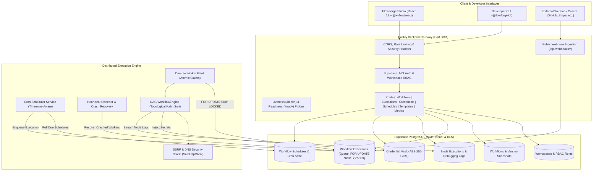

# FlowForge — Visual Workflow Programming Studio & Distributed Automation Platform

[](https://www.typescriptlang.org/)
[](https://react.dev/)
[](https://fastify.dev/)
[](https://supabase.com/)
[](https://vitejs.dev/)
[](https://tailwindcss.com/)
[](https://reactflow.dev/)
[](https://vitest.dev/)
[](https://playwright.dev/)
[](LICENSE)

FlowForge is a web-native, full-stack **Visual Workflow Programming Studio and Distributed Automation Platform**. It enables software engineers and technical teams to design, connect, test, execute, and monitor complex automation graphs through a responsive node-based canvas backed by an enterprise-grade execution engine.

Built from first principles with **React 19**, **strict TypeScript**, **@xyflow/react**, **Fastify**, and **Supabase PostgreSQL**, FlowForge combines the intuitive developer experience of modern visual tooling with the fault tolerance, security, and observability expected of mission-critical backend systems.

---

## 🌟 Key Features

### 1. Visual Studio & Node Graph Editor
- **Interactive Canvas**: Drag-and-drop node palette, multi-selection, smooth pan/zoom, interactive minimap, undo/redo (`Ctrl+Z` / `Ctrl+Y`), copy/paste (`Ctrl+C` / `Ctrl+V`), and snap-to-grid controls.
- **Port Validation & Connection Rules**: Prevents invalid self-connections, duplicate edges, loop creation, and disallowed port-to-port mappings at drag time.
- **Node Inspector & Config Panels**: Type-safe dynamic configuration forms with real-time Zod schema validation, environment variable interpolation, and JSON code editors.

### 2. Decoupled DAG Execution Engine
- **Kahn’s Topological Sorting**: Computes deterministic execution order and instantly detects circular dependency cycles with detailed cycle traces (e.g., `NodeA -> NodeB -> NodeA`).
- **Asynchronous Concurrency**: Concurrently executes independent branches using bounded worker concurrency pools.
- **Branch-Aware Routing**: Condition nodes selectively activate `true` or `false` downstream branches while gracefully propagating `skipped` statuses to inactive nodes.

### 3. Durable Execution Queue & Background Workers
- **Database-Backed Queue**: Uses PostgreSQL `FOR UPDATE SKIP LOCKED` for atomic, race-free job claims across distributed worker instances.
- **Crash Recovery & Heartbeats**: Background sweepers automatically detect crashed worker processes (heartbeat $>30\text{s}$ stale) and recover interrupted jobs.
- **Configurable Retry Policies**: Declarative linear and exponential backoff with full jitter to avoid thundering-herd spikes against third-party APIs.
- **Reliable Cancellation**: Immediately halts in-flight executions, releases worker capacity, and records cancellation events.

### 4. Enterprise Credential Vault
- **AES-256-GCM Encryption**: Secrets and tokens are encrypted at rest with authenticated 96-bit IVs and 128-bit authentication tags.
- **Zero-Exposure Policy**: Secrets are never returned to the browser or stored in plaintext in the database.
- **Runtime Injection & Scrubbing**: Vault secrets (`{{vault.SECRET_NAME}}`) are resolved in worker memory immediately prior to execution and automatically redacted from logs, timelines, and error messages.

### 5. Multi-Trigger Ingestion
- **Manual Triggers**: Interactive execution with customizable JSON test payloads.
- **Public Webhook Ingestion**: Dedicated public ingestion endpoints (`/api/webhooks/:path`) with HTTP method routing, Bearer token verification, and HMAC-SHA256 signature validation.
- **Scheduled Cron Automations**: In-database cron scheduler supporting standard 5-part cron syntax, timezones, pause/resume, and missed-run catchup logic.

### 6. Time-Travel Debugging & Partial Replay
- **Immutable State Snapshots**: Every workflow execution persists complete, immutable input and output snapshots for every single node.
- **Partial Replay from Node**: Select any historical execution, inspect its intermediate data, and replay the workflow from any chosen node forward without re-running earlier steps.

### 7. Workflow Testing Laboratory
- **Automated Scenario Testing**: Define multiple named test scenarios with structured input payloads and multi-target assertion rules.
- **8 Assertion Operators**: `equals`, `not_equals`, `contains`, `does_not_contain`, `greater_than`, `less_than`, `exists`, `does_not_exist`.
- **Suite Runs & Diff Inspection**: Run entire test suites with instant pass/fail reporting, execution latencies, and output diffs.

### 8. Production Observability & Health Probes
- **Liveness & Readiness Probes**: Separate `/health` (process memory, uptime) and `/ready` (DB latency, worker capacity, queue depth) endpoints with production credential masking.
- **Execution Metrics & Percentiles**: Workspace-scoped analytics computing success/failure rates, queue wait times, duration percentiles (`p50`, `p90`, `p95`), and node-level failure breakdowns.
- **Real-Time Monitoring UI**: Live dashboard with customizable time windows (`1h`, `24h`, `7d`, `30d`), auto-refresh toggles, SVG volume/failure charts, and long-running execution alerts (>30s).
- **Structured JSON Logging**: Pino-powered logging with request correlation IDs and automated secret redaction.

### 9. Developer CLI (`@flowforge/cli`)
- Standalone command-line tool (`flowforge`) for authenticating, listing, pulling, pushing, validating, and exporting workflows directly from terminal environments and CI/CD pipelines.

---

## 🏛 System Architecture



---

## 📦 Built-in Node Catalog (16 Production Nodes)

| Category | Node Name | Type ID | Description |
| :--- | :--- | :--- | :--- |
| **Triggers** | **Manual Trigger** | `manualTrigger` | Workflow starting point accepting custom JSON test payloads |
| | **Webhook Trigger** | `webhookTrigger` | Ingests external HTTP requests with path routing & HMAC validation |
| | **Schedule Trigger** | `scheduleTrigger` | Automated execution via standard 5-part cron expressions |
| **Logic** | **Condition** | `condition` | Multi-rule conditional branching with distinct `true` and `false` output routing |
| **Data Processing** | **Transform Data** | `transformData` | Pure declarative JSON path extraction, field picking, and key renaming |
| | **String Operations** | `stringOps` | String manipulation (trim, case conversion, replace, regex extraction) |
| | **Math Operations** | `mathOps` | Mathematical computations (arithmetic, rounding, clamp) |
| | **Filter Data** | `filterData` | Array filtering based on item conditions |
| | **Map Data** | `mapData` | Array element transformation and key projection |
| | **Merge Data** | `mergeData` | Combines two upstream data streams (deep merge, shallow merge, append) |
| | **JSON Parse** | `jsonParse` | Parses raw JSON strings into structured objects with fallback |
| | **JSON Stringify** | `jsonStringify` | Serializes objects into compact or indented JSON strings |
| | **Date & Time** | `dateTime` | Date formatting, ISO conversions, and duration offsets |
| **Flow Control** | **Delay** | `delay` | Configurable pause with safe execution bounds |
| **Actions** | **HTTP Request** | `httpRequest` | Secure REST client with header configuration & strict SSRF defense |
| | **Webhook Response**| `webhookResponse`| Returns custom status codes and payloads to incoming webhook callers |
| | **Console Output** | `consoleOutput` | Multi-level runtime telemetry inspector (`info`, `warn`, `error`, `success`) |

---

## 💻 Technology Stack

| Component | Technology | Version | Purpose |
| :--- | :--- | :--- | :--- |
| **Frontend Framework** | React | `19.3.1` | Modern concurrent UI layer |
| **Language** | TypeScript | `~6.0.2` | Strict type safety, zero `any` policy |
| **Bundler & Dev Server**| Vite | `8.3.8` | Sub-second HMR and production builds |
| **Canvas Engine** | @xyflow/react | `13.0.2` | Interactive node-based graph editor |
| **Styling** | Tailwind CSS | `4.3.5` | Modern CSS-first developer theme |
| **State Management** | Zustand | `5.1.0` | Segregated document, UI, and execution state |
| **Schema Validation** | Zod | `4.6.7` | Type-safe runtime schemas and validations |
| **Backend Framework** | Fastify | `5.12.8` | High-performance HTTP server with plugins |
| **Database & Auth** | Supabase PostgreSQL | `2.119.2` | Relational data, RLS, and JWT auth |
| **Cryptography** | Node.js Crypto | Native | AES-256-GCM authenticated encryption |
| **Unit & Integration** | Vitest | `5.1.1` | High-speed unit and integration test runner |
| **E2E Testing** | Playwright | `1.65.1` | Headless browser integration tests |
| **Iconography** | Lucide React | `1.76.0` | Developer tool iconography |

---

## 🚀 Quickstart Guide

### Prerequisites
- Node.js `18.0.0` or higher
- npm `9.0.0` or higher

### 1. Installation
```bash
git clone https://github.com/your-username/flowforge.git
cd flowforge
npm install
```

### 2. Environment Configuration
```bash
cp .env.example .env.local
```
*(The default `.env.example` comes pre-configured with local development fallbacks.)*

### 3. Launch Development Servers
Run the backend server and frontend studio:

```bash
# Terminal 1: Backend Fastify Server & Worker
npm run server

# Terminal 2: Frontend Vite Studio
npm run dev
```
Open [http://localhost:5173](http://localhost:5173) in your browser.

---

## 💻 Developer CLI (`flowforge`)

FlowForge includes a powerful CLI located in `packages/cli/`:

```bash
# Display CLI help and command options
npm run cli -- --help

# Validate a workflow JSON file offline
npm run cli -- workflow validate examples/01_user_onboarding_pipeline.json

# Export a workflow safely without exposing secrets
npm run cli -- workflow export <workflow-id> --out ./exported-workflow.json

# List cloud workflows in your workspace
npm run cli -- workflow list

# Pull a workflow from your cloud workspace to local disk
npm run cli -- workflow pull <workflow-id> --out ./workflow.json

# Push a local workflow to your cloud workspace
npm run cli -- workflow push ./workflow.json --overwrite
```

---

## 🧪 Testing & Verification

FlowForge enforces a strict zero-regression testing standard with **353 tests across 26 suites**:

```bash
# Run all unit and integration test suites
npm test

# Run ESLint code quality checks
npm run lint

# Run strict TypeScript typechecking
npx tsc --noEmit

# Run production bundle build
npm run build

# Run end-to-end browser tests
npm run test:e2e

# Run production smoke test against staging or production URLs
npm run smoke-test
```

---

## 🔒 Security & SSRF Defense

- **Zero-Trust Network Client (`SafeHttpClient`)**:
  - Rejects IPv4 private networks (RFC 1918: `10.0.0.0/8`, `172.16.0.0/12`, `192.168.0.0/16`), loopbacks (`127.0.0.0/8`), link-local metadata addresses (`169.254.169.254`), carrier-grade NAT (`100.64.0.0/10`), and IPv6 equivalents (`::1`, `fc00::/7`, `fe80::/10`).
  - **DNS Re-Resolution**: Performs immediate DNS resolution at connection time to defeat TOCTOU DNS rebinding attacks.
  - **Port Allowlisting**: Restricts outbound traffic to standard ports (80, 443, 8080, 8443) and blocks internal service ports (SSH, Redis, MySQL, Postgres).
- **Workspace RBAC**:
  - Role hierarchy: `owner` > `admin` > `developer` > `viewer`.
  - Viewers are strictly read-only; execution triggers and edits require `developer` or above; secret creation requires `admin` or above.
- **Log & Header Redaction**:
  - Automatic scrubbing of `Authorization`, `Cookie`, `X-Api-Key`, and vault secrets across all execution logs, error messages, and metrics.

---

## 📚 In-Depth Documentation

Detailed architectural specifications and guides are available in the [`docs/`](docs/) directory:
- [Architecture & Portfolio Case Study](docs/architecture-and-portfolio-case-study.md) — Comprehensive technical whitepaper
- [5-Minute Quickstart Walkthrough](docs/quickstart-walkthrough.md) — Interactive evaluation guide
- [Durable Execution & Queue Architecture](docs/durable-execution.md) — Atomic claims & recovery
- [Credential Vault & Security Design](docs/credential-vault-security.md) — AES-256-GCM encryption & injection
- [Time-Travel Debugging & Replay](docs/time-travel-debugging.md) — State reconstruction & node replays
- [Monitoring & Observability](docs/monitoring-and-observability.md) — Probes, metrics, and alerting
- [Scaling & Performance Manual](docs/scaling-and-performance.md) — Connection pooling & load boundaries
- [Production Operations (SOP)](docs/production-operations.md) — Deployments, restarts, and incident recovery
- [Developer CLI Guide](docs/cli-guide.md) — CLI usage and automation recipes

---

## 📄 License
This project is licensed under the MIT License — see the [LICENSE](LICENSE) file for details.
