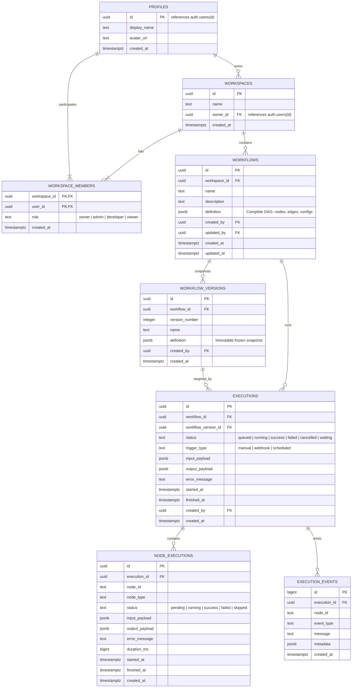

# FlowForge Database Architecture & Migration Guide

## 1. Overview

FlowForge combines relational integrity with document flexibility:
- **Workspaces, Users, Versions, and Executions** are strictly relational entities governed by PostgreSQL foreign keys and Row Level Security (RLS).
- **Workflow Definitions and Payloads** are stored as `JSONB`, allowing the visual DAG canvas to evolve its node configurations, layout positions, and custom parameters without requiring DDL alterations on every canvas feature change.

---

## 2. Entity Relationship Diagram

---

## 3. Database Schema Design Principles

1. **UUID Primary Keys**: Every entity uses a cryptographically secure random UUID (`gen_random_uuid()`) to prevent enumeration attacks and facilitate distributed record generation.
2. **Immutable Version Snapshots (`workflow_versions`)**: Workflows are constantly modified in the visual canvas. Every deployment or published run freezes a point-in-time snapshot so executing workers always run against an immutable definition, even if an author modifies the canvas mid-flight.
3. **Dual Execution Tracking (`executions` & `node_executions`)**:
   - `executions` tracks macro status, top-level inputs/outputs, trigger context, and wall-clock execution duration.
   - `node_executions` tracks fine-grained node-by-node runtime records, isolated outputs, input mappings, error stack traces, and latency.
4. **Row Level Security (RLS) & Workspace Isolation**:
   - All public tables have RLS enabled.
   - Membership is evaluated via the security-definer helper functions:
     - `is_workspace_member(target_workspace_id uuid)`
     - `has_workspace_role(target_workspace_id uuid, allowed_roles text[])`
     - `get_workspace_role(target_workspace_id uuid)`
   - Data across workspaces is strictly isolated.
5. **No Secrets in Workflow Definitions**:
   - Headers and API keys in HTTP nodes are masked (`maskHeaders`) and referenced by secret IDs in future credential stores rather than stored in plain text JSONB.

---

## 4. Role-Based Access Control (RBAC) Permission Matrix

| Action | Owner | Admin | Developer | Viewer |
|---|---|---|---|---|
| View workspace | Yes | Yes | Yes | Yes |
| View workflows | Yes | Yes | Yes | Yes |
| Create workflows | Yes | Yes | Yes | No |
| Edit workflows | Yes | Yes | Yes | No |
| Delete workflows | Yes | Yes | No | No |
| Manage members | Yes | Yes | No | No |
| Change member roles | Yes | Yes | No | No |
| Delete workspace | Yes | No | No | No |

- Only the **Owner** can transfer ownership or delete a workspace.
- The **Owner** cannot be removed from the workspace unless ownership is transferred first.

---

## 5. Applied Migrations

### Migration 1: `20261122100000_flowforge_core_database.sql`
- Creates core tables: `profiles`, `workspaces`, `workspace_members`, `workflows`, `workflow_versions`, `executions`, `node_executions`, `execution_events`.
- Establishes cascading foreign keys and performance indexes.
- Enables Row Level Security on all tables with baseline `SELECT` policies.
- Adds `is_workspace_member(uuid)` helper function.

### Migration 2: `20261122110000_auth_triggers_and_rbac_policies.sql`
- Creates `on_auth_user_created` trigger on `auth.users` to automatically generate user profiles and a default `Personal Workspace` where the user is `owner`.
- Adds `has_workspace_role(uuid, text[])` and `get_workspace_role(uuid)` helper functions with `SECURITY DEFINER` and restricted execution rights.
- Implements secure stored procedures for:
  - `create_workspace(name text)`
  - `add_workspace_member_by_email(target_workspace_id uuid, target_email text, member_role text)`
  - `update_workspace_member_role(target_workspace_id uuid, target_user_id uuid, new_role text)`
  - `remove_workspace_member(target_workspace_id uuid, target_user_id uuid)`
  - `delete_workspace(target_workspace_id uuid)`
- Establishes granular write RLS policies for `INSERT`, `UPDATE`, and `DELETE` on all 8 tables according to the RBAC matrix.

---

## 6. Google OAuth Setup Instructions

To enable Google sign-in:
1. Navigate to Google Cloud Console -> **APIs & Services** -> **Credentials**.
2. Create an **OAuth 2.0 Client ID** (Web Application).
3. Set **Authorized redirect URIs** to your Supabase redirect URI:
   `https://<your-project-ref>.supabase.co/auth/v1/callback`
4. In the Supabase Dashboard, open **Authentication** -> **Providers** -> **Google**.
5. Enable Google and paste your **Client ID** and **Client Secret**.
6. The FlowForge frontend UI will now automatically complete the OAuth exchange.
