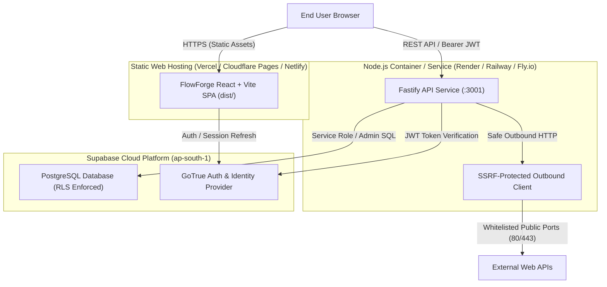

# FlowForge MVP Cloud Deployment Guide

This guide details the deployment architecture, configuration parameters, manual setup steps, and operational procedures for deploying FlowForge to production.

---

## 1. Deployment Architecture



### Components
1. **Frontend (SPA):** Static single-page application built with Vite (`npm run build`). Output directory: `dist/`. Hosted on any modern static hosting platform (Cloudflare Pages, Vercel, Netlify, or S3/CloudFront).
2. **Backend API (Node.js Service):** Fastify REST service running on Node.js 22+. Handles authoritative workflow execution, RBAC, execution snapshotting, and safe outbound HTTP requests.
3. **Database & Authentication (Supabase):** PostgreSQL with Row Level Security (RLS) policies, database triggers, and GoTrue authentication.

---

## 2. Environment Variables Matrix

| Variable | Environment | Scope | Confidentiality | Description |
| :--- | :--- | :--- | :--- | :--- |
| `VITE_SUPABASE_URL` | Frontend & Backend | Public | Safe for browser | Supabase project API URL |
| `VITE_SUPABASE_ANON_KEY` | Frontend & Backend | Public | Safe for browser | Supabase public anonymous API key |
| `VITE_API_URL` | Frontend | Public | Safe for browser | URL of the deployed Fastify backend |
| `PORT` | Backend | Server Only | Internal | Port for Fastify server (e.g. `3001` or provided by `$PORT`) |
| `HOST` | Backend | Server Only | Internal | Bind address (`0.0.0.0` for containers/cloud) |
| `NODE_ENV` | Backend | Server Only | Internal | Must be set to `production` |
| `SUPABASE_URL` | Backend | Server Only | Internal | Supabase project API URL |
| `SUPABASE_ANON_KEY` | Backend | Server Only | Internal | Supabase public anon key |
| `SUPABASE_SERVICE_ROLE_KEY` | Backend | Server Only | **HIGHLY SENSITIVE** | Privileged server-only Supabase service-role secret |
| `CORS_ORIGIN` | Backend | Server Only | Internal | Explicit production origin(s), e.g. `https://flowforge.app` |
| `RATE_LIMIT_MAX` | Backend | Server Only | Internal | Requests per minute per IP (default `100` or `200`) |
| `ENFORCE_HTTPS` | Backend | Server Only | Internal | Set to `true` to reject unencrypted HTTP |

> [!CAUTION]
> **Zero Credential Leakage Rule:** `SUPABASE_SERVICE_ROLE_KEY` must **never** be prefixed with `VITE_` or added to the frontend hosting environment. If exposed to the browser, an attacker would bypass all database RLS policies.

---

## 3. Step-by-Step Deployment Instructions

### Step 1: Supabase Database Migrations
1. In the Supabase Dashboard, navigate to **SQL Editor**.
2. Apply the migration scripts in strict sequential order from `supabase/migrations/`:
   - `20261122100000_flowforge_core_database.sql` (Tables, Foreign Keys, Indexes, RLS)
   - `20261122110000_auth_triggers_and_rbac_policies.sql` (Auth Triggers, Membership Functions)
   - `20261122120000_execution_node_label.sql` (Node Label tracking)
   - `20261123100000_production_hardening.sql` (Interrupted Status check constraint & indexes)
3. Alternatively, link your local repository to Supabase CLI:
   ```bash
   npx supabase link --project-ref <your-project-id>
   npx supabase db push
   ```

### Step 2: Configure Supabase Authentication & OAuth
1. Go to **Supabase Dashboard > Authentication > URL Configuration**:
   - **Site URL:** `https://your-frontend-domain.app`
   - **Redirect URLs:** Add:
     - `https://your-frontend-domain.app/**`
     - `https://your-frontend-domain.app/auth/callback`
2. **Google OAuth Configuration:**
   - In Google Cloud Console > APIs & Services > Credentials:
     - Authorized JavaScript Origins: `https://your-frontend-domain.app`
     - Authorized Redirect URIs: `https://<your-supabase-project-id>.supabase.co/auth/v1/callback`
   - In Supabase Dashboard > Authentication > Providers > Google:
     - Enable Google Provider
     - Enter Client ID and Client Secret from Google Cloud Console.

### Step 3: Deploy the Backend API Service (e.g., Render / Railway / Fly.io)
1. Create a new **Web Service** pointing to your Git repository.
2. Configure service parameters:
   - **Environment:** Node.js (v22+)
   - **Build Command:** `npm ci`
   - **Start Command:** `npm run server`
   - **Health Check Path:** `/health`
3. Configure Environment Variables:
   ```env
   NODE_ENV=production
   PORT=3001
   HOST=0.0.0.0
   SUPABASE_URL=https://<your-supabase-id>.supabase.co
   SUPABASE_ANON_KEY=<your-anon-key>
   SUPABASE_SERVICE_ROLE_KEY=<your-service-role-key>
   CORS_ORIGIN=https://your-frontend-domain.app
   RATE_LIMIT_MAX=200
   ENFORCE_HTTPS=true
   ```
4. Verify deployment:
   ```bash
   curl -I https://your-backend-api.app/health
   # Expected: HTTP/2 200 OK with security headers
   curl https://your-backend-api.app/ready
   # Expected: {"status":"ready","database":"connected",...}
   ```

### Step 4: Deploy the Frontend Static Web App (e.g., Cloudflare Pages / Vercel / Netlify)
1. Create a new static project pointing to your Git repository.
2. Configure build settings:
   - **Framework Preset:** Vite
   - **Build Command:** `npm run build`
   - **Output Directory:** `dist`
3. Configure Environment Variables:
   ```env
   VITE_SUPABASE_URL=https://<your-supabase-id>.supabase.co
   VITE_SUPABASE_ANON_KEY=<your-anon-key>
   VITE_API_URL=https://your-backend-api.app
   ```
4. **SPA Single Page Rewrite Rule:**
   - **Vercel:** Handled automatically or via `vercel.json`:
     ```json
     { "rewrites": [{ "source": "/(.*)", "destination": "/index.html" }] }
     ```
   - **Netlify:** `_redirects` file in `public/`:
     ```
     /* /index.html 200
     ```
   - **Cloudflare Pages:** Handled automatically for SPA projects.

---

## 4. Production Smoke Test Procedure

Run the automated smoke test script after deployment:
```bash
npx tsx scripts/smokeTest.ts --api-url=https://your-backend-api.app --web-url=https://your-frontend-domain.app
```

### Manual Verification Checklist
1. **Frontend Load:** Open `https://your-frontend-domain.app`. Verify that the dark canvas, TopNav, left palette, and right inspector render without console errors.
2. **Auth Flow:** Click **Sign In**, log in with email/password or Google OAuth. Verify session persists after browser reload.
3. **Workspace Isolation:** Verify active workspace loads; switch workspaces and verify workflows match the selected workspace.
4. **Workflow Execution:** Run a cloud workflow. Verify:
   - Backend initiates run (`202 Accepted`).
   - Frontend polls execution details and updates node statuses in real-time.
   - Run logs and events appear in the bottom debugger panel.
5. **SSRF Gate:** Create an HTTP Request node with URL `http://169.254.169.254/latest/meta-data/`. Run workflow. Verify execution fails with SSRF validation error.
6. **Viewer Restriction:** Invite or log in as a `viewer`. Verify workflow execution and edit attempts return `403 Forbidden`.

---

## 5. Rollback & Recovery Procedures

### Frontend Rollback
- Static hosting providers (Vercel, Cloudflare Pages, Netlify) retain instantaneous deployment snapshots. In the provider dashboard, click on the previous successful deployment and select **Rollback to this deployment**.

### Backend API Rollback
1. In the backend hosting dashboard (e.g. Render/Railway), select the previous release tag or Git commit hash.
2. Trigger re-deployment.
3. On boot, the backend automatically runs `reconcileStaleExecutions()` to safely mark any in-flight runs as `failed` with an interrupted status.

### Database Recovery
1. Supabase automatically retains Point-In-Time Backups (PITR) and daily backups.
2. To restore: Supabase Dashboard > Settings > Database > Backups > Select restore timestamp.
