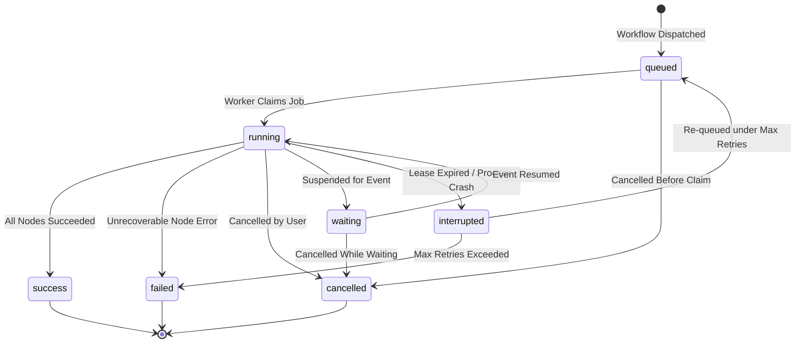

# FlowForge Durable Workflow Execution Architecture

## 1. Overview & Motivation

In previous batches (Batches 1–8), workflow executions were initiated directly in the Fastify backend memory. While performant for local development, this in-memory model had critical reliability limitations:

1. **Vulnerability to Backend Restarts**: If the backend process crashed, deployed a new version, or was restarted, all active in-flight executions were severed abruptly without recording a terminal state or allowing cleanup.
2. **Execution Loss**: Workflow triggers dispatched during downtime or high load could not be safely queued or persisted.
3. **No Lease or Worker Tracking**: There was no record of which server instance was executing a workflow, preventing multi-instance concurrency or automated recovery.

Batch 9 introduces a **PostgreSQL-backed durable execution engine** that persists execution requests before processing, utilizes atomic job claiming to prevent double execution across worker nodes, maintains active leases with heartbeats, and guarantees robust recovery of interrupted runs.

---

## 2. PostgreSQL Queue Model

Instead of introducing heavy distributed infrastructure (e.g., Redis, RabbitMQ, Kafka) at the MVP stage, FlowForge leverages PostgreSQL transactions, row-level locking, and timestamp indices already present in the Supabase database.

### 2.1 Database Schema Extensions

The `public.executions` table is augmented with the following queue control columns (migration `20261123120000_durable_execution_and_retries.sql`):

| Column | Type | Default | Description |
|---|---|---|---|
| `worker_id` | `text` | `NULL` | Identifier of the worker process currently executing or holding the lease |
| `lease_expires_at` | `timestamptz` | `NULL` | Absolute timestamp when the worker lease expires if not renewed by heartbeat |
| `last_heartbeat_at` | `timestamptz` | `NULL` | Most recent timestamp when the worker reported active progress |
| `retry_count` | `integer` | `0` | Number of recovery attempts or retry executions completed so far |
| `max_retries` | `integer` | `3` | Maximum allowed automated retries before marking an execution permanently failed |
| `cancellation_requested` | `boolean` | `false` | Explicit cancellation flag persisted immediately upon user or API request |
| `cancellation_reason` | `text` | `NULL` | Optional audit explanation for the cancellation request |
| `available_at` | `timestamptz` | `NOW()` | Timestamp before which workers must not claim the execution (used for retry backoff) |

Indices on `(status, available_at)` and `(status, lease_expires_at)` ensure high-throughput querying of claimable and stale executions even with large historical datasets.

---

## 3. Atomic Job Claiming Algorithm

To guarantee that multiple worker processes or concurrent worker threads never claim or execute the same workflow simultaneously:

### 3.1 SQL Stored Function (`claim_next_execution`)
When supported by PostgreSQL, an atomic transaction using row-level locking claims the next available job:

```sql
SELECT id INTO v_execution_id
FROM public.executions
WHERE status = 'queued'
  AND cancellation_requested = FALSE
  AND available_at <= NOW()
ORDER BY created_at ASC
LIMIT 1
FOR UPDATE SKIP LOCKED;

IF v_execution_id IS NOT NULL THEN
  UPDATE public.executions
  SET status = 'running',
      worker_id = p_worker_id,
      started_at = COALESCE(started_at, NOW()),
      lease_expires_at = NOW() + (p_lease_duration_ms || ' milliseconds')::interval,
      last_heartbeat_at = NOW()
  WHERE id = v_execution_id;
END IF;
```

### 3.2 Optimistic Concurrency Fallback
For environments where stored procedures are bypassed, the `DurableWorkerService` implements atomic optimistic claiming:
1. Queries candidate executions where `status = 'queued' AND cancellation_requested = false AND available_at <= now()`.
2. Issues an atomic `UPDATE executions SET status = 'running', worker_id = :workerId ... WHERE id = :candidateId AND status = 'queued'`.
3. If another worker claimed the job concurrently, the `UPDATE` matches 0 rows and returns null, preventing collision.

---

## 4. Execution Lifecycle & State Machine

FlowForge enforces an explicit, unidirectional state machine governing all workflow runs:



### Allowed State Transitions

| From Status | Allowed Target Statuses | Disallowed Invalid Transitions |
|---|---|---|
| `queued` | `running`, `cancelled` | `success`, `failed`, `interrupted` |
| `running` | `success`, `failed`, `cancelled`, `waiting`, `interrupted` | `queued` (direct without backoff) |
| `waiting` | `running`, `cancelled`, `failed` | `success` |
| `interrupted` | `queued`, `failed`, `cancelled` | `running`, `success` |
| `success` | *(terminal)* | Any transition (rejected by state machine) |
| `failed` | *(terminal)* | Any transition (rejected by state machine) |
| `cancelled` | *(terminal)* | Any transition (prevents late worker overwrites) |

---

## 5. Delivery Semantics & Side-Effect Safety

FlowForge guarantees **at-least-once delivery** for queued workflow executions.

> [!WARNING]
> Because external systems (e.g., HTTP Request nodes calling third-party webhooks, payment processors, or messaging APIs) may exhibit external side effects, executing a workflow multiple times can result in duplicate external calls unless endpoints are idempotent.

To maximize safety:
- Completed nodes persist their individual execution status (`success`, `failed`, `skipped`) and output payload in `node_executions`.
- State reconciliation verifies whether preceding tasks completed before re-triggering.
- The `isErrorRetryable` classifier differentiates between non-retryable 4xx client errors (which fail immediately) and transient 5xx server outages.
