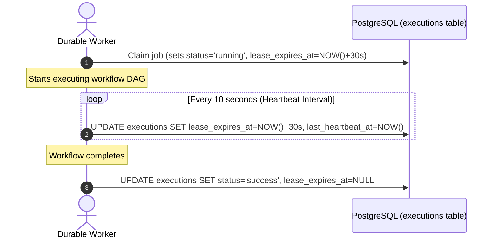

# FlowForge Execution Recovery, Heartbeats & Graceful Shutdown

## 1. Overview

In distributed and containerized architectures, backend instances can restart unexpectedly due to:
- Rolling deployments and platform autoscaling
- Node evictions or container host crashes
- Out-of-memory (OOM) killer events

Batch 9 implements **active lease heartbeats, automated stale lease reclamation, and graceful process shutdown** to ensure that interrupted executions are reliably detected and recovered without human intervention.

---

## 2. Worker Leases & Heartbeat Management

When a worker claims an execution, it takes exclusive ownership by obtaining a time-limited lease.



### Key Parameters:
- **Default Lease Duration**: `30,000 ms` (30 seconds)
- **Heartbeat Interval**: `10,000 ms` (10 seconds)
- **Recovery Poll Interval**: `15,000 ms` (15 seconds)

---

## 3. Stale Lease Recovery Scanner

If a worker process crashes, its heartbeat loop terminates immediately. The database record remains in `status = 'running'`, but its `lease_expires_at` timestamp will no longer be refreshed.

Every 15 seconds, surviving or restarted worker processes scan for expired leases:

```sql
SELECT id, retry_count, max_retries
FROM public.executions
WHERE status = 'running'
  AND lease_expires_at < NOW()
ORDER BY lease_expires_at ASC
LIMIT 10;
```

### Recovery Actions:

1. **Under Max Retries (`retry_count < max_retries`)**:
   - The execution is transitioned to `interrupted`.
   - Log event `execution_recovered`: *"Lease expired for abandoned execution. Re-queuing for retry attempt X."*
   - Re-queued with exponential backoff:
     ```sql
     UPDATE public.executions
     SET status = 'queued',
         retry_count = retry_count + 1,
         worker_id = NULL,
         lease_expires_at = NULL,
         available_at = NOW() + INTERVAL '5 seconds'
     WHERE id = :id AND status = 'interrupted';
     ```

2. **Exceeded Max Retries (`retry_count >= max_retries`)**:
   - The execution is marked as permanently `failed`.
   - Error message recorded: *"Execution abandoned by worker and exceeded maximum retry attempts."*
   - Log event `execution_failed`: Details preserved in audit timeline.

---

## 4. Reliable Cancellation

FlowForge guarantees that cancellation requests take effect immediately and are immune to race conditions:

### 4.1 Immediate Persistence
When a user clicks "Cancel" or sends `POST /api/workspaces/:workspaceId/executions/:executionId/cancel`:
1. `cancellation_requested` is immediately set to `true` in the database.
2. If `status == 'queued'`, it transitions immediately to `cancelled` and will never be picked up by any worker.
3. If `status == 'running'`, the in-memory `AbortController` for that execution is aborted.

### 4.2 Terminal Guard Against Late Overwrite
If a running worker finishes executing nodes while a cancellation request is being processed:
1. Before committing final status, the worker fetches the current row state from the database.
2. If `current.cancellation_requested === true` or `current.status === 'cancelled'`, the worker **rejects** overwriting the status to `success` or `failed`.
3. The terminal status remains `cancelled`, ensuring user intent is strictly respected.

---

## 5. Graceful Worker Shutdown

When a server receives termination signals (`SIGTERM` or `SIGINT`):
1. **Stop Ingestion**: The worker immediately stops polling for new queued executions.
2. **Heartbeat Maintenance**: The heartbeat loop continues renewing leases for currently in-flight executions.
3. **Grace Period Wait**: The server waits up to a configurable grace period (default: `10,000 ms`) for active executions to complete.
4. **Clean Abort**: If executions remain active when the grace period expires, `AbortController.abort()` is called, and remaining leases are released for immediate recovery by other instances.
