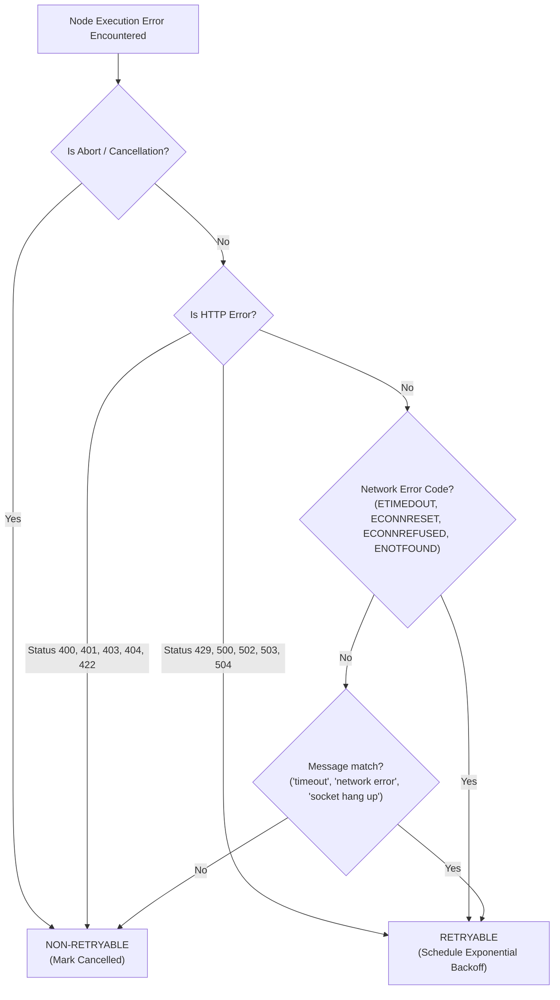

# FlowForge Configurable Retry Policies & Error Classification

## 1. Overview

Workflows interacting with external networks, APIs, and microservices encounter transient failures: rate limits, connection timeouts, DNS hiccups, and temporary HTTP 503 service outages. Retrying blindly wastes resources and risks amplifying outages, while failing immediately breaks critical automations.

Batch 9 introduces **configurable retry policies** with:
- Intelligent error classification (differentiating transient from permanent errors)
- Full-jitter exponential backoff calculation
- Node-level and execution-level attempt audit logs
- Cancellation-aware delay loops

---

## 2. Configurable Retry Parameters

Retry policies can be defined globally or per node in the workflow definition:

| Parameter | Type | Default | Description |
|---|---|---|---|
| `maxRetries` | `number` | `3` | Maximum number of retry attempts allowed after an initial failure (e.g., 3 retries = 4 total attempts). |
| `initialIntervalMs` | `number` | `1000` | Delay in milliseconds before the first retry attempt. |
| `backoffMultiplier` | `number` | `2.0` | Factor by which the delay increases with each subsequent retry attempt. |
| `maxIntervalMs` | `number` | `30000` | Maximum cap on delay between retry attempts (30 seconds). |
| `jitterRatio` | `number` | `0.2` | Fraction of calculated delay randomized to prevent synchronized retry spikes. |

---

## 3. Error Classification: Transient vs Permanent

FlowForge classifies execution errors to ensure only transient, recoverable errors are retried.

### 3.1 Non-Retryable Errors
The following errors terminate execution immediately without retrying:
- **Client Errors (HTTP 4xx)**: `400 Bad Request`, `401 Unauthorized`, `403 Forbidden`, `404 Not Found`, `422 Unprocessable Entity`.
- **Validation Failures**: Invalid JSON payload, missing required schema properties, syntax errors in transform expressions.
- **SSRF Blockage**: Private IP address or loopback access blocked by SSRF guards.
- **User Cancellation**: Abort signals triggered by manual cancellation or timeout.

### 3.2 Retryable (Transient) Errors
The following errors trigger retry with exponential backoff:
- **Rate Limits**: `429 Too Many Requests`.
- **Server Errors**: `500 Internal Server Error`, `502 Bad Gateway`, `503 Service Unavailable`, `504 Gateway Timeout`.
- **Network Failures**: `ETIMEDOUT`, `ECONNRESET`, `ECONNREFUSED`, `ENOTFOUND`, `EAI_AGAIN`.

---

## 4. Full-Jitter Exponential Backoff Calculation

To prevent "thundering herd" problems where hundreds of retries strike an external service at the exact same millisecond, FlowForge applies bounded jitter:

$$\text{baseDelay} = \min(\text{maxIntervalMs}, \text{initialIntervalMs} \times \text{backoffMultiplier}^{(\text{attempt} - 1)})$$

$$\text{jitterDelta} = \text{baseDelay} \times \text{jitterRatio}$$

$$\text{finalDelay} = \text{baseDelay} - \text{jitterDelta} + (2 \times \text{jitterDelta} \times \text{random}())$$

### Example Schedule (`initialIntervalMs = 1000`, `multiplier = 2.0`, `max = 30000`, `jitter = 0.2`):
- **Attempt 1 Failure**: Delay $\approx 1000\text{ ms} \pm 200\text{ ms}$ (800ms – 1200ms)
- **Attempt 2 Failure**: Delay $\approx 2000\text{ ms} \pm 400\text{ ms}$ (1600ms – 2400ms)
- **Attempt 3 Failure**: Delay $\approx 4000\text{ ms} \pm 800\text{ ms}$ (3200ms – 4800ms)

---

## 5. Attempt Tracking & Audit Logging

Every retry attempt is recorded in two places:
1. `public.node_executions`:
   - `retry_count`: Total retry attempts made on this node.
   - `attempt_logs`: JSONB array of attempt records containing `{ attempt, error, timestamp, durationMs }`.
2. `public.execution_events`:
   - Emits `node_retrying` event containing error details, next retry delay, and attempt count.
   - Visible in real-time on the frontend Timeline and Execution Logs panels.
