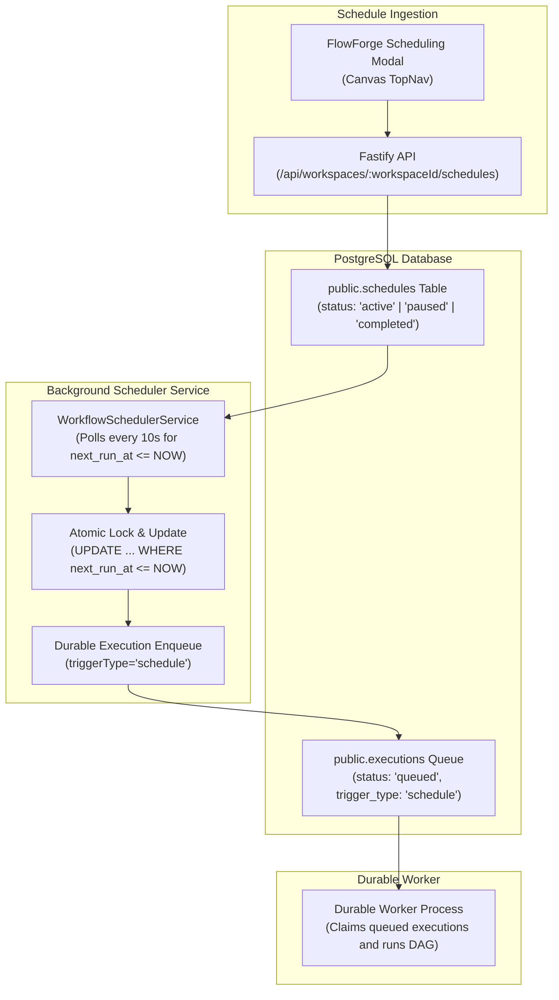

# FlowForge Scheduled Workflows & Recurring Automation

## 1. Scheduling Architecture

FlowForge provides a resilient, PostgreSQL-backed workflow scheduling system integrated directly into the durable execution engine.

Workflows can be scheduled to run:
- **One-Time Execution**: Target a specific future date and time (e.g. for database migrations, product launches, or delayed reports).
- **Recurring Execution**: Configurable standard 5-part cron expressions with IANA timezone support.



---

## 2. Cron Syntax & Supported Presets

FlowForge uses a zero-dependency, high-precision cron parser supporting standard 5-part POSIX cron format:

$$\begin{matrix}
\text{Minute} & \text{Hour} & \text{Day of Month} & \text{Month} & \text{Day of Week} \\
(0-59) & (0-23) & (1-31) & (1-12) & (0-6,\text{ Sun}=0)
\end{matrix}$$

### Supported Presets and Shortcuts

| Preset | Equivalent Cron | Description |
|---|---|---|
| `every_minute` | `* * * * *` | Fires at the start of every minute |
| `every_5_minutes` | `*/5 * * * *` | Fires every 5 minutes (00, 05, 10, 15, ...) |
| `every_15_minutes` | `*/15 * * * *` | Fires every 15 minutes (00, 15, 30, 45) |
| `@hourly` / `every_hour` | `0 * * * *` | Fires every hour on the hour (:00) |
| `@daily` / `@midnight` | `0 0 * * *` | Fires every day at midnight (00:00) |
| `0 9 * * 1-5` | `0 9 * * 1-5` | Fires every weekday at 9:00 AM |
| `@weekly` | `0 0 * * 0` | Fires every Sunday at midnight |
| `@monthly` | `0 0 1 * *` | Fires on the 1st day of every month at midnight |

---

## 3. Timezone & Daylight Saving Time (DST) Handling

All schedule timestamps are stored internally in PostgreSQL as UTC `timestamptz`. When evaluating cron expressions, FlowForge uses the configured IANA timezone (e.g. `America/New_York`, `Europe/London`, `Asia/Kolkata`).

### Daylight Saving Shifts
- **Spring Forward (e.g., EST $\rightarrow$ EDT)**: Clocks jump forward 1 hour. A 9:00 AM New York schedule automatically evaluates to 13:00 UTC (instead of 14:00 UTC in winter).
- **Fall Back (e.g., EDT $\rightarrow$ EST)**: Clocks fall back 1 hour. Wall-clock time is preserved.

---

## 4. Missed-Run Recovery Policy

When a server restarts after downtime or an active schedule is resumed, FlowForge evaluates what should happen to occurrences scheduled during the outage:

| Missed-Run Policy | Behavior After Downtime | Best Used For |
|---|---|---|
| `skip` *(default)* | Skips all missed occurrences and immediately advances `next_run_at` to the next future occurrence. Prevents accidental bursts of executions. | Periodic synchronization, reporting, telemetry cleanup. |
| `run_once` | Executes exactly **one** catch-up execution immediately, then advances `next_run_at` to the next future occurrence. | Financial billing runs, critical digest generation. |

---

## 5. Duplicate Prevention & Atomic Claiming

To prevent multiple scheduler instances from firing the same schedule occurrence:
1. **Row-Level Locking**: Workers query candidate due schedules and claim them using atomic updates with pre-condition checks:
   ```sql
   UPDATE public.schedules
   SET last_run_at = NOW(),
       next_run_at = :nextCalculatedRunAt,
       status = :newStatus
   WHERE id = :scheduleId 
     AND status = 'active'
     AND next_run_at <= NOW();
   ```
2. If another instance claims the tick concurrently, 0 rows are updated and duplicate dispatch is avoided.

---

## 6. Workspace RBAC & Permissions

- **Owners, Admins, Developers**: Full access to create, update, pause, resume, and delete schedules.
- **Viewers**: Read-only access to view schedules and execution history. Any attempt to modify, pause, or delete returns `403 Forbidden`.
- **Workspace Isolation**: Schedule IDs are strictly validated against `workspace_id`. Requests referencing schedule IDs belonging to other workspaces return `404 Not Found`.
