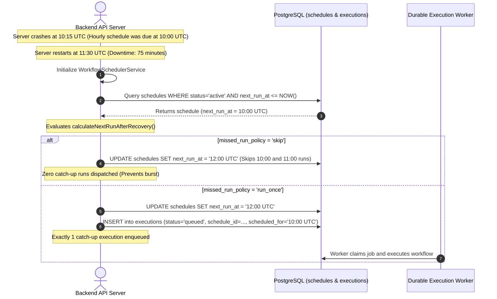

# FlowForge Scheduler Recovery & Crash Resilience

## 1. Overview

In production environments, backend servers may undergo rolling restarts, process crashes, or container autoscaling. A fragile in-memory scheduler risks either dropping scheduled runs permanently or flooding the system with a burst of overdue executions.

FlowForge’s `WorkflowSchedulerService` relies on **persistent database timestamps and state reconciliation** to guarantee smooth recovery without duplicate executions or unmanaged bursts.

---

## 2. Server Crash & Restart Scenarios



---

## 3. Anti-Burst Architecture

A common failure mode in cron schedulers is the "backlog storm": after 24 hours of maintenance, a schedule configured to run every minute attempts to execute 1,440 executions back-to-back, crashing workers and exhausting rate limits.

FlowForge eliminates this problem:
1. `calculateNextRunAfterRecovery()` computes the single nearest future run timestamp:
   ```typescript
   const nextFutureRun = getNextCronRun(cronExpression, now, timezone);
   ```
2. If `missed_run_policy === 'skip'`, `next_run_at` advances immediately to `nextFutureRun` with 0 executions enqueued.
3. If `missed_run_policy === 'run_once'`, exactly one execution is enqueued, and `next_run_at` advances to `nextFutureRun`.

Under no circumstances will FlowForge ever enqueue more than one execution for past missed occurrences.

---

## 4. Idempotency & Duplicate Occurrence Prevention

To guarantee that duplicate executions are never dispatched:
1. The scheduler performs atomic optimistic locking:
   ```sql
   UPDATE public.schedules
   SET last_run_at = NOW(),
       next_run_at = :nextCalculatedRunAt,
       status = :newStatus
   WHERE id = :scheduleId 
     AND status = 'active'
     AND next_run_at <= NOW();
   ```
2. The returned execution record links `schedule_id` and `scheduled_for` timestamp.
3. If two server instances poll the database concurrently at the exact same millisecond, only the instance whose transaction commits first will match the row condition `next_run_at <= NOW()`. The losing instance receives 0 updated rows and skips cleanly.

---

## 5. Graceful Scheduler Shutdown

When the backend server receives a shutdown signal (`SIGTERM` or `SIGINT`):
1. `workflowSchedulerService.stop()` is invoked.
2. The active polling interval timer is cleared via `clearInterval(this.pollTimer)`.
3. In-flight schedule claims complete their database transaction before the process exits.
4. Active executions continue running under the `DurableWorkerService` grace period.
