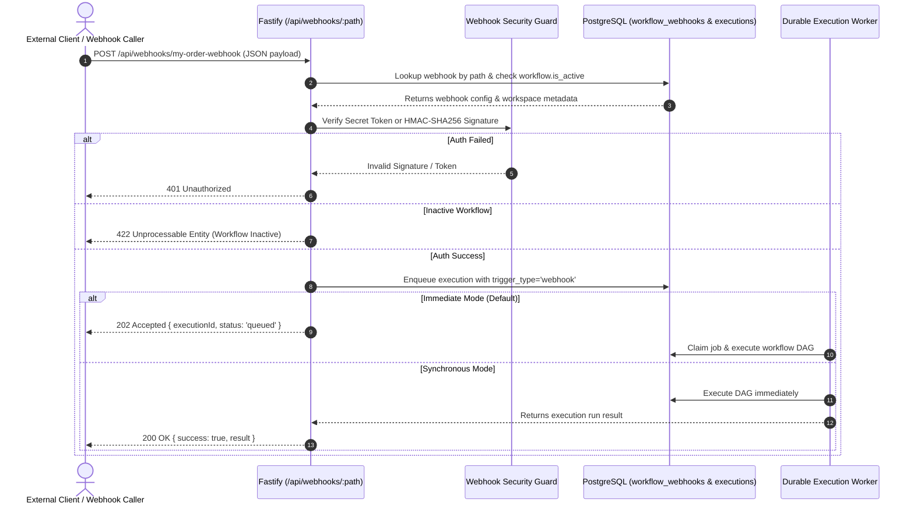

# FlowForge Webhook Triggers & Public Endpoints

## 1. Overview

In Batch 10, FlowForge introduces the **Webhook Trigger Node** (`webhook-trigger`), allowing workflows to be executed in response to inbound external HTTP requests. Webhooks enable integrations with third-party services such as GitHub, Stripe, Shopify, Slack, and custom client applications.

---

## 2. Architecture & Ingestion Flow



---

## 3. Webhook Authentication Modes

FlowForge supports four authentication strategies:

| Auth Type | Description | Header Checked | Example Value |
|---|---|---|---|
| `none` | Public endpoint (no credential check) | None | N/A |
| `header-secret` | Static secret token matching | Custom (e.g. `X-Webhook-Secret`) | `sec_9f8a7b6c5d4e` |
| `bearer-token` | Bearer token in standard Authorization header | `Authorization` | `Bearer sec_9f8a7b6c5d4e` |
| `hmac-sha256` | Cryptographic signature over raw request body using SHA-256 | `X-Hub-Signature-256` or custom | `sha256=a1b2c3d4...` |

### Timing-Safe Verification
To prevent timing attacks where attackers guess tokens character-by-character based on response latency, FlowForge enforces constant-time comparison via Node.js `crypto.timingSafeEqual`:

```typescript
crypto.timingSafeEqual(Buffer.from(received), Buffer.from(expectedSecret));
```

---

## 4. Node Downstream Data Structure

When triggered via webhook, the `WebhookTriggerExecutor` outputs structured data on port `output`:

```json
{
  "payload": {
    "orderId": "ord_1024",
    "amount": 250.00,
    "customer": "Alice"
  },
  "headers": {
    "content-type": "application/json",
    "user-agent": "Shopify-Webhook-Agent"
  },
  "query": {
    "env": "production"
  },
  "method": "POST",
  "path": "my-order-webhook",
  "triggeredAt": 1700000000000
}
```

Downstream nodes (such as Condition or Transform Data) can access properties directly via property paths, e.g.:
- `payload.orderId`
- `method`
- `query.env`

---

## 5. Rate Limiting & Protection

- Public webhook endpoints are rate-limited via `@fastify/rate-limit`.
- Max payload body size is enforced by Fastify server configuration (`BODY_LIMIT = 1MB`).
- Workflows can be toggled inactive/active at any time; incoming webhooks to inactive workflows are rejected immediately with `422 Unprocessable Entity` without consuming worker execution quota.
